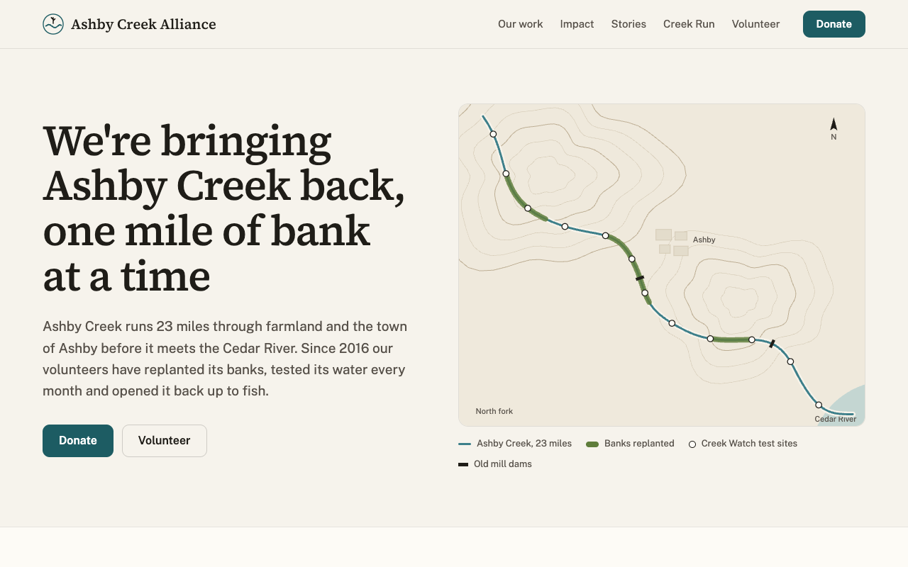

# Nonprofit and charity website template

A website for a nonprofit or charity: mission, programs, impact numbers, stories with their own pages, an upcoming fundraiser, a donate section that hands off to your donation page, and a volunteer form. Built with Astro as a fully static site.



[](https://console.cloudzyro.com/new?repo=https://github.com/Cloudzyro/template-nonprofit)

## What's included

- Hero with a drawn field map of the place you work (contour lines, the creek, replanted banks, test sites and dams), built in SVG
- Mission, three programs, and impact numbers clearly marked as sample figures until you replace them
- Stories: a featured quote on the home page and a page for every story (`/stories/<slug>/`)
- Upcoming fundraiser with date, place, entry prices, a sign-up link and a progress bar toward the goal
- Donate section: choose an amount (each says what it pays for), optionally monthly, then continue to your donation page with the amount filled in
- Volunteer form with interests that posts to any form service, with an email fallback
- SEO: page titles and descriptions, Open Graph and Twitter cards, `sitemap-index.xml`, `robots.txt`, favicon
- Responsive down to 360px, keyboard friendly, visible focus styles, respects reduced motion
- No tracking and no third-party scripts; fonts are self-hosted

## Run it locally

```bash
pnpm install
pnpm dev       # http://localhost:4321
pnpm build     # static site in dist/
pnpm preview   # serve the build
```

Requires Node 22.23 or newer (`.nvmrc` pins 24).

## Make it yours

**Content.** Everything lives in [`src/data/site.ts`](./src/data/site.ts): name, address, email, navigation, hero, mission, programs, impact numbers, stories, the fundraiser, donation amounts and volunteer interests. Add `legal` (for example your 501(c)(3) status and EIN) to show it in the footer. The impact numbers and the fundraiser total in the template are samples: replace them with your own before publishing.

**Donations.** Set `donateUrl` to your donation page (Givebutter, Donorbox, Every.org, a Stripe or PayPal link). The chosen amount is sent as `?amount=50` and monthly gifts add `&frequency=monthly`; change `donateAmountParam` if your provider expects another name. No payment details ever touch this site.

**Volunteer form.** Set a public environment variable to the address your form service gives you:

```bash
PUBLIC_FORM_ENDPOINT=https://formspree.io/f/your-form-id
```

It works with Formspree, Basin, a Supabase function or anything that accepts a form POST. Without it, the form says it isn't connected yet and opens the visitor's email app addressed to `contactEmail` with their answers filled in. Copy `.env.example` to `.env` for local development; on Cloudzyro, add the variable in your site's settings and redeploy.

**Site address.** Set `SITE_URL` (or edit the fallback in `astro.config.mjs`) so the sitemap, `robots.txt` and social previews use your domain.

**Colors and fonts.** Tokens are at the top of [`src/styles/global.css`](./src/styles/global.css); `--creek` is the one accent. Fonts are Source Serif 4 for headings and Public Sans for text, from Fontsource; change the imports in `src/layouts/Base.astro`.

**Images.** The map is `src/components/CreekMap.astro`: move the creek path, the replanted stretches, test sites and dams to fit your own place, or replace it with a photo from `public/` with alt text. Replace `public/og.png` (1200x630) with your own social preview.

## Deploy

Click **Deploy to Cloudzyro** above, or push your own copy to GitHub and connect the repository in the Cloudzyro console. The build command is `pnpm build` and the output is the static `dist/` folder, so no server is needed.

## Stack

- [Astro](https://astro.build) 7, static output
- Hand-written CSS with custom properties
- [Fontsource](https://fontsource.org) self-hosted fonts
- `@astrojs/sitemap`

## License

MIT, see [LICENSE](./LICENSE).
